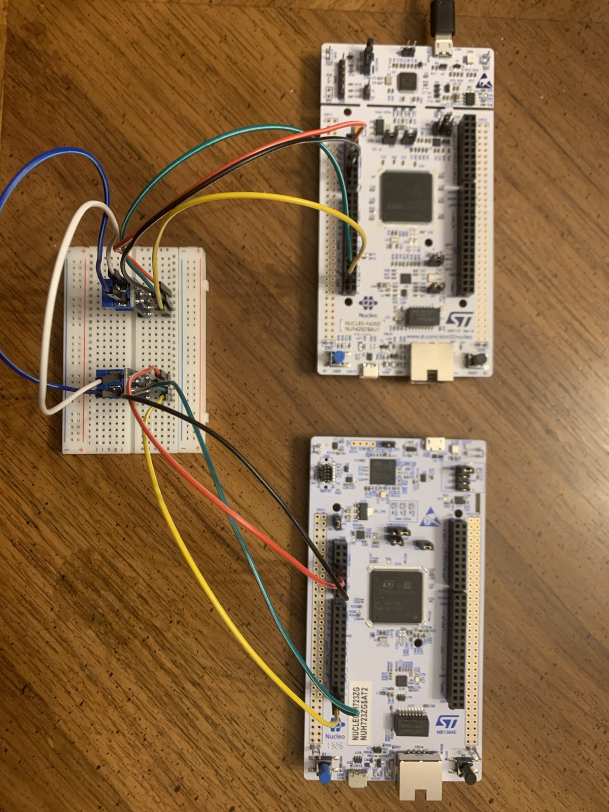

# CAN Bus

## Project 1: Two-Node CAN Network

- Goal: Build a 2-node CAN bus network in C between STM32F429 (bxCAN) and STM32H723 (FDCAN) Nucleo boards, sending periodic sensor frames at 500 kbps with hardware acceptance filtering and interrupt-driven RX

### Wiring

Transceivers: Waveshare SN65HVD230 (3.3 V). Pins are the same on both boards (PD0/PD1, AF9, on the CN9 connector).

| Waveshare pin | NUCLEO-F429ZI | NUCLEO-H723ZG |
|---|---|---|
| 3V3 | 3V3 | 3V3 |
| GND | GND | GND |
| CTX | PD1 (CAN1_TX) | PD1 (FDCAN1_TX) |
| CRX | PD0 (CAN1_RX) | PD0 (FDCAN1_RX) |

Bus connections between the two transceivers:

| Waveshare #1 | Waveshare #2 |
|---|---|
| CANH | CANH |
| CANL | CANL |
| GND | GND |

- Wire TX to CTX and RX to CRX straight through (not crossed).
- Each Waveshare board has a 120 Ω termination resistor, so the bus is terminated at both ends. With power off, CANH to CANL should measure about 60 Ω.

### Bit Timing (500 kbps)

Bit rate = clock ÷ (prescaler × (1 + Seg1 + Seg2)). Sample point = (1 + Seg1) ÷ (1 + Seg1 + Seg2).

| Setting | NUCLEO-F429ZI (bxCAN) | NUCLEO-H723ZG (FDCAN) |
|---|---|---|
| CAN clock | APB1 = 45 MHz (180 MHz system clock) | FDCAN kernel clock = 80 MHz |
| Prescaler | 6 | 10 |
| Seg1 | 12 tq (BS1) | 13 tq (NominalTimeSeg1) |
| Seg2 | 2 tq (BS2) | 2 tq (NominalTimeSeg2) |
| SJW | 1 tq | 1 tq |
| Time quanta per bit | 15 | 16 |
| Sample point | 86.7% | 87.5% |

FDCAN notes for the H723ZG:

- Set `FrameFormat = FDCAN_FRAME_CLASSIC` so it can talk to the F429's bxCAN. Don't send CAN FD frames on this bus.
- Set nonzero message RAM sizes (`StdFiltersNbr`, `RxFifo0ElmtsNbr`, `TxFifoQueueElmtsNbr` ≥ 1, with 8-byte data fields). If they are left at zero, the peripheral will not send or receive.
